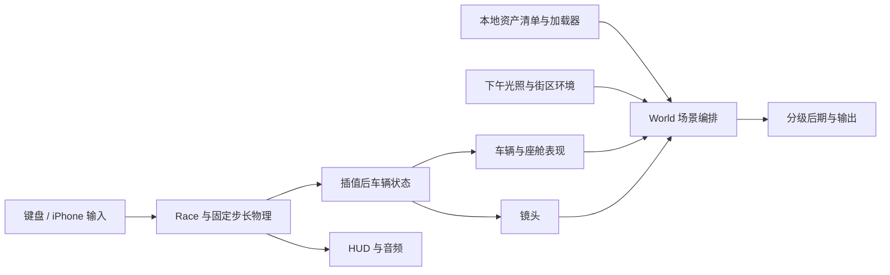

# 晴天下午写实城市赛车 Implementation Plan

> **For Claude:** REQUIRED SUB-SKILL: Use superpowers:executing-plans to implement this plan task-by-task.
> 本项目后续执行时使用当前环境已安装的 `executing-plans` 技能；上面的技能名是计划模板约定。本文记录原始方案；电脑端实施结果见 `docs/visual/acceptance.md`。手机真机验收按用户指示延后。

**Goal:** 将 Greyport 升级为晴天下午的写实城市赛车，让车辆、街景、材质、日照、阴影、反射与驾驶视角在同一个真实尺度下协调一致。

**Architecture:** 保留现有输入、比赛状态机和 iPhone 通信链路，在现有 Three.js 上拆分资产、场景、车辆、光照、镜头和后期模块。先完成一辆车与约 150–200 米街区的可驾驶样板，通过画面与性能检查后推广至完整约 764 米环线。以固定日照、静态环境烘焙和必要的动态阴影组合控制成本。

**Tech Stack:** 当前项目 Three.js 0.187.0、Vite 8.3.5、JavaScript ES modules、Node.js、现有 Swift iPhone 控制端；计划加入 glTF/GLB 模型、HDR 环境、PBR 纹理、KTX2 压缩及匹配的本地解码器。

---

## 1. 已确认方向与工作假设

- 用户已选择：**晴天下午的真实城市街道**。
- 第一版围绕一辆精细跑车、一条完整城市环线和现有五种镜头完成；视觉统一优先于车辆数量。
- 默认以当前 Mac 上的桌面浏览器为画面端，iPhone 继续作为方向盘。执行首步记录具体设备、浏览器和分辨率，帧率目标以该设备实测为准。
- 美术建议：自然蓝天、略暖阳光、偏冷的天空补光、灰色干燥沥青；少量生活痕迹，不把全城统一染黄或染绿。
- 城市建议：临街商业、砖混老街、工业仓储三段相连的城市街区，采用一致的建筑和道路语言。首次样板决定细节风格，不声称复刻某座真实城市。
- 光照初始标定可用约 35° 太阳高度角，选择与主直道形成斜侧光的方位；这是美术基准，**不等同于指定日期地点的真实下午时间**。
- 默认先筛选可随游戏分发的免费资产。尚未选定车辆模型；模型本身的质量、内饰完整性与许可是第一阶段必须解决的依赖。
- 原规划阶段未改实现；后续已实施电脑端 0.5.0，具体完成范围、性能取舍和素材许可边界以验收记录为准。

## 2. 当前状态与主要差距

| 已检查位置 | 现状 | 对改造的影响 |
|---|---|---|
| `src/game/urban-assets.js` | 跑车由样条车身与几何零件生成；道路 512 px、立面 256 px Canvas 纹理 | 轮廓、轮拱、接缝、灯组、建筑近景细节需要实质升级 |
| `src/game/world.js` | 渐变天空作为环境反射；统一暖灰雾与黄绿色调；单个 2048 阴影覆盖约 200 米宽 | 环境反射缺少街景，阴影精度有限，色彩校准需要重新建立 |
| `src/game/cockpit.js` | 独立场景和固定局部灯光，车外遮挡不直接作用于内饰 | 车转弯或进入楼影时，车内日照难与车外保持一致 |
| `src/game/world.js` | 路灯、部分树木等采用实例化；立面与楼体仍高度重复 | 需要保留批处理优势，同时增加结构变化与街区组织 |
| `shared/physics.js` | 平面运动学模型、速度相关转向、简化护栏碰撞，无悬架和高程 | 车身动态应先与现有状态解耦；若增加坡度需同步扩展道路采样与碰撞 |
| `src/game/audio.js` | 单振荡器合成发动机 | 最终可用发动机、胎噪、风噪分层补全真实感 |
| `src/game/main.js` | 场景同步创建 | 外部资产需要异步启动、加载进度、重试及正确的可开始状态 |
| `server/index.js`、`vite.config.js` | 仅服务扁平的 `/game/assets/`；`publicDir: false`；缺少细分资源 MIME | 模型、图片、音频、压缩纹理和解码器必须进入可验证的本地构建链路 |

2026-11-18 基线：`npm test` **41/41 通过**；`npm run test:lap` 完成三圈、零碰撞、全部有效；`npm start` 中的生产构建通过，有现有 JS 包超过 700 kB 的提示。已观察展示与座舱画面；本轮未做性能基准或真机手机三圈验收。浏览器观察值不能代替完整赛道帧时间统计。

## 3. 路线选择与架构决定

### ADR-01：在现有 Three.js 上重建写实画面（推荐）

| 方案 | 收益 | 成本与限制 | 决定 |
|---|---|---|---|
| 原模型上只调光影和滤镜 | 改动小，较快看到差异 | 模型、立面和树木的近景上限不变 | 不作为全面改造方案 |
| Three.js + 精细资产 + 重建场景与光照 | 延续浏览器与 iPhone 使用方式，可分阶段交付 | 需要资产制作/筛选与主动控制 GPU 成本 | 采用 |
| 迁移原生大型游戏引擎 | 可使用不同的高端渲染工具链 | 客户端、资源构建和控制集成都需重新评估，部署方式改变 | 暂不采用；仅在样板无法满足经确认的目标时重新讨论 |

### ADR-02：先做可驾驶样板，再铺完整环线

样板必须同时包含最终候选车辆、直路与一个弯道、临街建筑、树木、建筑阴影、路面细节和座舱。它是资产质量、光照一致性、碰撞边界和性能的共同验收点。不能用离线渲染图替代实时画面，也不能把占位模型视为写实完成。

### ADR-03：统一车内外坐标、视角与光照

优先把实际车辆内饰放回统一世界坐标，驾驶相机使用真实眼位，按镜头控制可见层。分离车身外壳、可见引擎盖、内饰和驾驶员，避免隐藏整辆车导致引擎盖或影子消失。显式处理可见层、投影层、车窗透明及近裁剪面。

若确有技术原因保留内饰单独渲染，必须共享太阳方向、曝光、环境和外部遮挡信息，并通过楼影与转向测试；固定补光灯不能继续代替室外光照。默认不引入额外第一人称位置滞后。

### ADR-04：固定下午光照与分级反射

先采用固定太阳、静态环境的间接光烘焙/环境探针，叠加车、树等必要动态阴影。阴影相机可随车辆移动，但世界中的太阳方向保持一致。优先区域反射探针；仅在高画质且有预算时启用低频动态捕获，捕获时排除车辆自身，避免反馈和反射错误。

### ADR-05：资产随项目构建并离线运行

保存模型、纹理、声音的来源、许可、版本和变换记录。开发时获取资源，运行时读取本机资源包。解码器同样本地化；按需要精确支持 Worker/WASM，不能以关闭既有来源限制解决加载问题。



## 4. 分阶段执行任务

以下列出的新文件都是计划路径。每项先形成可检查结果，通过对应验收后进入下一项；实现时再拆为短小提交，不在规划阶段提交功能代码。

### Task 1：参考、基线与资产可行性

**Files**
- Create: `docs/visual/realism-reference.md`
- Create: `docs/visual/baseline.md`
- Create: `assets/source-manifest.json`
- Create: `assets/ATTRIBUTIONS.md`

**步骤**
1. 记录硬件、浏览器、画面尺寸和像素比；采集同一路段与机位的基线截图、帧时间和绘制统计。
2. 按车身前后 45°、侧面、驾驶眼位、道路近景、街角与楼影建立少量真实照片参考。
3. 筛选一个车辆候选：外形、实际尺寸、完整内饰、可独立转向/滚动的轮组、材质分组及许可都要可用。
4. 筛选一致的建筑模块、扫描路面/混凝土/砖材、树木与晴天天空，记录下载体积与可压缩性。
5. 给出候选资产实机预览；若免费候选质量不足，明确缺口并估算原创建模或付费候选成本，先完成可审阅的比较。

**验收**：资产可获取、可分发、可编辑，关键节点完整；有统一的照片参考及画面预算。高清材质不能补救错误的车身轮廓。

### Task 2：资产加载与本地构建链路

**Files**
- Create: `src/game/assets/manifest.js`
- Create: `src/game/assets/load-assets.js`
- Create: `src/game/assets/dispose-assets.js`
- Create: `assets/runtime/`（存放经过优化的运行资源与必要解码器）
- Modify: `src/game/main.js`, `src/game/index.html`, `src/game/urban.css`
- Modify: `vite.config.js`, `server/index.js`, `package.json`
- Test: `tests/assets.test.js`, `tests/integration.test.js`

**步骤**
1. 制定资产清单、节点命名、米制尺寸、车头方向和贴图通道规范；校正模型坐标与枢轴。
2. 让模型与普通纹理经构建输出，解码器按固定映射复制；优先维持已有扁平资源路由。
3. 补齐 GLB、KTX2、HDR、WASM、图片、音频等实际使用格式的响应类型和缓存策略。
4. 实现关键资源预加载、可选资源延迟加载、进度显示、超时重试与资源释放；失败时明确提示或使用标明的兼容资源。
5. 等待关键资产可用后启用比赛；资产加载期间远程开始指令必须沿用既有确认机制返回明确结果，不能假成功或重复执行。
6. 测试资源 URL、404、重复加载、释放、本地离线运行及解码器兼容；若采用子目录路由，再增加路径边界测试。

**验收**：生产构建后的 URL 全部可访问，无运行期外部 CDN 依赖；模型或贴图加载失败不造成空白页或比赛状态失配。

### Task 3：渲染基准与真实下午光照

**Files**
- Create: `src/game/rendering/renderer.js`
- Create: `src/game/rendering/lighting.js`
- Create: `src/game/rendering/postprocessing.js`
- Create: `src/game/rendering/quality.js`
- Modify: `src/game/world.js`
- Test: `tests/render-config.test.js`

**步骤**
1. 把 renderer、光照、后期配置从 `World` 拆出；保持一个明确的线性工作空间和最终色调/输出转换。
2. 在中性校准场景中检查颜色贴图与法线、粗糙度等数据贴图的色彩空间；移除当前全局黄绿色调作为写实基准。
3. 建立同向的太阳、天空与环境反射，锁定曝光和白平衡，避免 HDR 天空与方向光产生两套日照方向。
4. 设计近景高精度阴影及远景降级，实测选择分级阴影或收紧覆盖范围；校准偏移，处理悬浮、条纹和移动闪烁。
5. 设置有限的间接光、接触阴影、环境遮蔽与空气透视；分别校验遮蔽强度，避免烘焙 AO 与后期 AO 叠黑。
6. 增加低强度、仅针对高亮的泛光；驾驶时保持道路清楚，不默认启用强景深、眩光或动态模糊。

**验收**：阳光、物体受光面、反射高光和落地阴影方向一致；车底贴地，白车漆不过曝，阴影中能辨认细节，视角变化不造成异常明暗跳动。

### Task 4：精细赛车与车辆动态

**Files**
- Create: `src/game/vehicle/vehicle.js`
- Create: `src/game/vehicle/materials.js`
- Create: `src/game/vehicle/vehicle-pose.js`
- Modify: `src/game/urban-assets.js`, `src/game/world.js`
- Test: `tests/vehicle-pose.test.js`, `tests/assets.test.js`

**步骤**
1. 接入通过筛选的 GLB，并统一车长、车宽、轴距、轮径、接地点与原点。
2. 完成轮拱、面板接缝、进气格栅、灯罩/灯腔、后视镜、排气和轮胎细节，按最终镜头距离分配几何。
3. 分别调校清漆车身、橡胶、玻璃、塑料、铝合金与制动盘；用车身曲面移动时的高光连续性检查法线质量。
4. 修正车轮转向和旋转轴；根据实际轮径从行驶距离计算滚动，不用速度猜视觉角度。
5. 接入受限的加速抬头、制动俯仰、转向侧倾和悬架视觉响应，暂停、重置和低帧率时保持稳定。
6. 灯罩自身发光与真实照明分开；白天下刹车灯可辨，灯具不溢光成大片光团。

**验收**：前后侧视轮廓符合参考，车轮与地面接触准确，接缝和轮拱具有实际结构；动态表现有重量且不改变手机转向的含义。

### Task 5：样板道路与完整街景

**Files**
- Create: `src/game/city/road.js`
- Create: `src/game/city/districts.js`
- Create: `src/game/city/buildings.js`
- Create: `src/game/city/props.js`
- Create: `src/game/city/vegetation.js`
- Modify: `src/game/world.js`, `src/game/urban-assets.js`
- Conditional: `shared/track.js`, `shared/physics.js`, `shared/presentation.js`（只有加入高程或改变赛道边界时）
- Test: `tests/city-layout.test.js`；赛道变化时扩展 `tests/driving.test.js`

**步骤**
1. 建设约 150–200 米样板：一段直路、一个弯道、开阔日照和建筑阴影，先达到最终目标质量。
2. 道路使用有实际尺度的基础色、法线和粗糙度；裂缝、修补、轮迹与污渍采用分布合理的覆盖层，处理重复和远处闪烁。
3. 重建路缘石、人行道铺装、井盖、雨水口、标线和道口接缝。正常行驶路线应平顺，细节不能变成明显鼓包。
4. 建筑采用实际门窗比例与层高，近景增加凹窗、窗台、店面、门廊、空调、招牌与屋顶设备；远景简化。
5. 用真实街区布局安排转角、侧街、前后退界和地标，避免沿赛道等距复制同一种楼；检查建筑及道具不侵入道路和重置点。
6. 以枝叶结构、透光叶片和轮廓自然的树木替换块状树冠；低幅风动与树影配合。
7. 按区域合理放置路牌、护栏、路灯、停放车辆、自行车、垃圾桶等生活细节，优先强化距离感和尺度感。
8. 样板合格后扩展至商业街、老街和工业段，保持环线连通与八检查点的比赛规则。

**高程边界**：若增设排水横坡、坡道或路缘可驶入区域，地形采样、车轮支撑与碰撞必须读取同一套道路数据；不能只抬高视觉网格让车辆悬空。第一样板可维持现有平面中心线，降低同时修改物理的风险。

**验收**：座舱视角下近景可信，远景有层次；路口和街段可辨认；车辆路线、碰撞面和可见道路一致。

### Task 6：座舱、驾驶员与镜头统一

**Files**
- Modify: `src/game/cockpit.js`, `src/game/instruments.js`, `src/game/windshield.js`
- Create: `src/game/vehicle/driver.js`
- Create: `src/game/rendering/camera-rig.js`
- Modify: `shared/camera.js`, `src/game/world.js`
- Test: `tests/cockpit.test.js`, `tests/instruments.test.js`, `tests/windshield.test.js`

**步骤**
1. 把内饰与外形对齐，建立座椅、仪表、方向盘、A 柱和驾驶眼位的真实空间关系。
2. 完成车内外统一光照：左转、右转和进入楼影时，方向盘、手臂和仪表台的受光正确变化。
3. 改善皮革、缝线、塑料、金属饰条和仪表玻璃，动态信息继续来自真实比赛状态。
4. 使用合适的手套/手臂模型和握持动画，校验左右输入、手腕与方向盘相对位置；按所需动作决定是否需要骨骼与 IK。
5. 保留眼位调节，检查最低/默认/最高眼位和宽窄画面，避免仪表挡路、A 柱异常侵占视野或身体穿模。
6. 对追逐镜头增加适度阻尼、弯道前视与遮挡避让；第一人称保持可靠跟随，头部微动为可关闭的舒适选项。
7. 外后视镜/车内镜反射按画质预算提供，使用受限分辨率与刷新率，避免额外完整场景渲染拖慢驾驶。

**验收**：五镜头切换正确；第一人称没有镜头掉入车身、挡风玻璃遮路或日照方向脱节；已确认的手机视觉转向仍然同向。

### Task 7：反射、空间细节和后期定稿

**Files**
- Create: `src/game/rendering/reflections.js`
- Modify: `src/game/rendering/lighting.js`, `src/game/rendering/postprocessing.js`
- Modify: `src/game/vehicle/materials.js`, `src/game/city/buildings.js`

**步骤**
1. 在关键街段建立环境反射探针，用平滑过渡或就近选择控制误差；检查金属车身能反映周围建筑的大形体。
2. 高画质试验低频动态反射，记录额外开销；无法达到预算时保留探针方案。
3. 调整建筑玻璃、车窗和车漆各自的反射强度及粗糙度，干燥柏油保持适当漫反射。
4. 校准静态间接光、树下阴影、轮胎接触阴影和远处空气透视，不能靠浓雾掩盖近景缺失。
5. 对固定机位逐项对照实景照片：透视比例、明暗层次、阴影方向、色温和材质识别。

**验收**：车辆行驶时反射不明显跳变，阴影与车轮接触可信；晴天下午场景中不存在无理由的大面积镜面地面。

### Task 8：驾驶反馈、声音与界面

**Files**
- Modify: `src/game/audio.js`, `src/game/main.js`
- Modify: `src/game/index.html`, `src/game/style.css`, `src/game/urban.css`
- Conditional: `shared/physics.js`, `shared/feedback.js`
- Test: 仅在改变动力学/输入行为时扩展 `tests/driving.test.js` 与相关回归

**步骤**
1. 按车速、负载和表面混合发动机、胎噪、风噪；有许可的采样不足时明确阶段性边界。
2. 加入车内外声场区别和轻量碰撞/路缘反馈，并遵守浏览器音频启用规则。
3. 整理 HUD 的速度、圈数、时间及必要提示；简化比赛视线中的遮挡，保留手机连接状态。
4. 增加画质档、镜头舒适选项和加载界面，保存用户选择。
5. 若调整转向、抓地或碰撞，单独说明并测试，不把视觉俯仰当成已实现真实悬架物理。

**验收**：画面和声音反馈相符，界面不压住主要行驶区域；手机断连暂停、恢复与重新校准行为正确。

### Task 9：性能、稳定性与完整验收

**Files**
- Create: `src/game/debug/render-stats.js`
- Create: `docs/visual/acceptance.md`
- Modify: `src/game/rendering/quality.js`, `README.md`
- Test: 全套现有测试及必要的新测试

**步骤**
1. 用同一设备、分辨率、路线和画质档记录平均帧率、P95 帧时间、绘制数、三角形、纹理估计成本和资源加载耗时。
2. 建立建筑/植被/车辆 LOD、实例化、材质合并、贴图压缩和视距剔除；每次按实测瓶颈优化。
3. 调整阴影、反射、AO、镜子、分辨率的分档预算，确保低档也能辨认车辆与道路。
4. 进行持续驾驶、暂停恢复、车辆重置、反复切镜头和资源重载检查，观察内存与帧时间趋势。
5. 跑自动测试与生产构建；执行真实 iPhone 的三圈、断连、重连及前后台切换验收，记录实际完成范围。
6. 保存同机位改造前后截图、实测性能及已知限制，更新启动和资源说明。

**目标，非当前承诺**：当前设备桌面浏览器 1920×1080、中画质以持续 60 FPS 为主要目标；首先记录真实基准，再锁定 P95 帧时间与质量阈值。不把视口内瞬时“60 FPS”作为完成证据。高画质允许成本更高，具体结果必须实测。

## 5. 资产与画面预算初稿

这些数字是第一样板的调优起点，不是最终验收保证。纹理解压后的 GPU 成本需单独评估，不能用压缩文件体积代替。

| 内容 | 起始策略 |
|---|---|
| 玩家车 | 近景外观约 8–15 万三角形量级；内饰独立计量、按镜头裁剪；远景逐级简化 |
| 贴图 | 大部分 1K–2K，4K 仅用于实测可辨认的关键近景；纹理集尽量复用 |
| 城市 | 近处保留立体门窗和招牌，中远处使用合并模块和 LOD |
| 阴影 | 优先驾驶区域；中档减少覆盖与级数，高档增加近处清晰度 |
| 反射与镜子 | 中档静态区域探针；高档按预算启用局部低频更新与镜子 |
| 首次加载 | 分离进入样板所需关键资源和远处可选资源，测量加载、解码、上传 GPU 三部分耗时 |
| 日照和天气 | 第一版固定晴天下午；雨后与夜景列为后续独立场景，不混进第一版验收 |

## 6. 测试与验收矩阵

| 场景 | 必须观察的结果 |
|---|---|
| 同一车辆正面、侧面、前后 45° | 真实比例、轮拱深度、接缝、灯组与连续曲面高光 |
| 同一物体旋转/车辆改变朝向 | 太阳固定在世界方向，车身和座舱受光随朝向变化 |
| 从直射阳光进入建筑阴影 | 车外和车内同时响应；无固定灯把内饰照成另一场景 |
| 低机位查看轮胎和路缘 | 无悬浮、穿插或与碰撞不一致的高度 |
| 五视角及 0/10/18 cm 眼位 | 无身体遮挡道路，仪表可读，镜头不过度滞后 |
| 树影/标线/建筑在行驶中 | 无明显闪烁、远景锯齿或 LOD 突跳 |
| 资源失效/冷启动/离线 | 清楚的加载与失败状态；关键资源未就绪不能开始假比赛 |
| 手机开始、暂停、断连与恢复 | 现有命令确认、输入新鲜度和失联暂停继续成立 |
| 完整三圈和长时间驾驶 | 成绩有效，控制无异常，帧时间与内存趋势可接受 |

运行命令及预期：

```bash
npm test
# 现有 41 项和新增的行为测试通过
npm run test:lap
# phase=finished，三圈有效；零碰撞作为现有基准，物理/赛道变化需说明差异
npm run build
# 生产构建成功，所有运行资产被正确输出
npm start
# 用生产资源实际打开 /game/ 完成视觉与控制验收
```

如果变更了 Swift 或跨端协议，再运行 `npm run test:swift` 并进行真机验收。图像质量依靠同机位截图和实时驾驶检查；不为颜色常量、装饰节点数量等实现细节编写脆弱测试。

## 7. 主要风险与处理

- **车辆资产质量不足**：先验证资产再铺场景；寻找更合适模型或原创补做，将成本与缺口透明记录。
- **只有静帧好看，驾驶掉帧**：样板即开始测量；优先减少反射重绘、透明层、阴影覆盖和高成本材质。
- **车内外照明不一致**：统一坐标与光照是必做项，楼影穿越作为独立验收案例。
- **资源压缩后加载失败**：把解码器、MIME、Worker/WASM 支持和离线构建作为前置工作。
- **碰撞、眼位与新车尺寸不匹配**：以米制资产和共同几何基准校验；对重置点、弯道边界和座舱视线做行为测试。
- **写实目标扩张为全新游戏**：先完成一车一环线；对手、开放世界、车辆损伤、完整交通模拟和动态天气各自另列功能阶段。

## 8. 阶段交付顺序

1. **资产与光照基准**：参考对照、车辆候选、资源可用性和性能记录。
2. **可驾驶写实样板**：最终候选车 + 150–200 米街区 + 下午光影 + 座舱一致性；先验证最重要的画面目标。
3. **完整城市环线**：分区街景、道路与生活细节、五视角和现有比赛流程。
4. **打磨与验收版本**：反射、声音、HUD、画质分档、真实手机和持续运行验证。

优先级：**资产轮廓与真实比例 → 材质和统一光照 → 道路与建筑近景 → 完整街区 → 反射和动态表现 → 声音与界面细化**。性能检查贯穿所有阶段。

## 9. 参考依据

- 当前项目源文件、`URBAN-EDITION.md`、`COCKPIT-UPDATE.md`，以及本轮构建、测试和浏览器观察。
- [Three.js MeshStandardMaterial](https://threejs.org/docs/pages/MeshStandardMaterial.html)：材质与法线贴图能力；法线贴图改变光照响应，不能替代真实轮廓几何。
- [Poly Haven 资产许可](https://polyhaven.com/license)：可作为 HDRI、扫描材质及部分模型的候选来源，其资产按 CC0 提供。本文尚未选定或下载具体资源；车辆模型需单独筛选。


## 实施状态

电脑端 0.5.0 已落地：资源链路、统一日照、精细车辆、完整街区、座舱与镜头、反射、音效/界面和桌面验收。格式选择为 WebP + Draco；持续车身反射按性能预算替换为区域探针。手臂仍是简化模型，音效为合成。实际结果见 `docs/visual/acceptance.md`。

手机真机测试按用户指示稍后进行；车模原始再分发许可仍需闭合，当前交付保留为本地开发版。
